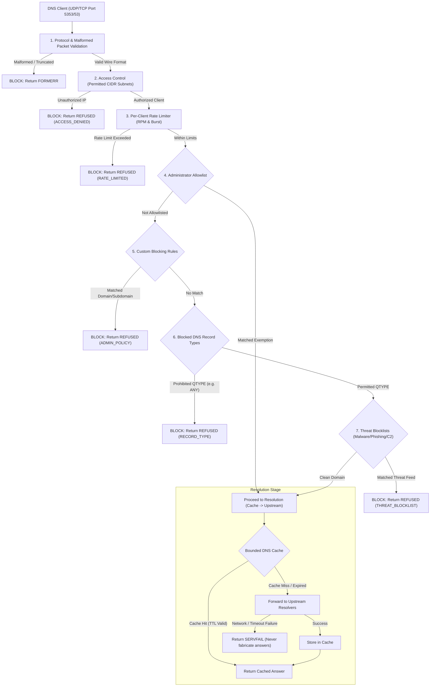

# DNS Security Gateway
## Deterministic ALLOW/BLOCK Policy Enforcement & Threat Mitigation Platform

[](https://www.python.org/downloads/)
[](https://opensource.org/licenses/MIT)
[](#automated-testing)
[](#security-decisions--enforcement-pipeline)

The **DNS Security Gateway** is an enterprise network security gateway that evaluates inbound DNS queries and produces one final, unambiguous verdict:
- **ALLOW**: Forward the request to configured upstream resolvers (or serve from bounded cache).
- **BLOCK**: Return an RFC-compliant blocking response (`REFUSED` by default, or optionally `NXDOMAIN`) without forwarding to upstream resolvers.

Decisions are governed strictly by **explicit administrator policies, validated threat blocklists, and protocol compliance**—eliminating probabilistic risk scores, threat percentages, and arbitrary severity thresholds from the active gating path.

---

## 1. System Architecture & Enforcement Pipeline

Every DNS query received over **UDP or TCP** traverses a strict, non-bypassable policy precedence hierarchy:



### Precedence Guarantees
1. **Allowlist Boundaries**: Allowlist entries override threat blocklists and custom block rules, but **never bypass protocol validation, access control, or rate limits**.
2. **Label-Boundary Precision**: Blocking `example.com` and its subdomains (`*.example.com`) strictly isolates the domain label; it **never falsely matches** `notexample.com` or `example.company`.
3. **Stale Cache Prevention**: Policy rules are evaluated **prior** to checking cache entries. If an administrator adds a block rule for a previously cached domain, subsequent queries are blocked immediately without serving the cached record.
4. **Upstream Fail-Safe**: When upstream resolvers are down or timeout, the gateway returns `SERVFAIL`. It **never fabricates successful answers**.
5. **Atomic Blocklist Swaps**: Threat feed updates are validated before activation. If a feed update fails or contains corrupt syntax, the gateway **retains the last known good list**.

---

## 2. Directory Structure

```
├── gateway/
│   ├── config.py             # Environment configuration (ports, CIDRs, timeouts)
│   ├── normalization.py      # RFC 1035/1123 domain syntax and IDN Punycode normalization
│   ├── matcher.py            # Label-boundary matching and fast candidate index
│   ├── blocklist_manager.py  # Atomic blocklist synchronization and fail-safe retain
│   ├── rate_limiter.py       # Thread-safe sliding-window rate limiter per client IP
│   ├── cache.py              # Bounded LRU cache with TTL countdown and domain invalidation
│   ├── upstream.py           # Multi-upstream forwarding (UDP/TCP failover and latency tracking)
│   ├── policy.py             # Deterministic decision engine (ALLOW / BLOCK)
│   └── server.py             # Concurrent UDP and TCP DNS Gateway server
├── api/
│   ├── main.py               # FastAPI REST and WebSocket endpoints
│   └── auth.py               # Administrative authentication (API Key / Bearer Token)
├── dashboard/
│   ├── index.html            # Dark SOC dashboard interface
│   ├── app.js                # Frontend telemetry, Chart.js, and CRUD logic
│   └── style.css             # Cyber-SOC styling and glassmorphism
├── data/
│   ├── blocklists/           # Sample curated malware, phishing, and C2 threat feeds
│   ├── dns_gateway.db        # SQLite persistence database (auto-initialized)
│   └── events/               # Preserved historical jsonl archive
├── docs/
│   ├── DEPLOYMENT.md         # Deployment, scope, firewall integration, and rollback guide
│   └── MIGRATION.md          # Architecture and data migration documentation
├── scripts/
│   └── migrate_legacy_data.py# Script to migrate legacy events into SQLite without risk scores
├── tests/
│   ├── test_gateway.py       # 12 Automated security and protocol tests
│   ├── test_api.py           # REST endpoints, CRUD, and authentication tests
│   └── ...
├── run.py                    # Master launcher (--server, --demo, --dns-port, etc.)
└── requirements.txt          # Python project dependencies
```

---

## 3. Quick Start & VS Code Instructions

### Step 1: Verify Dependencies
Ensure Python 3.11+ is installed. In VS Code Terminal (PowerShell or Bash):
```bash
py -3.11 -m pip install -r requirements.txt
```

### Step 2: Configure Environment
Copy `.env.example` to `.env` (or use built-in defaults):
```bash
cp .env.example .env
```
An administrative API key is automatically generated in `data/admin_key.txt` on first launch if not configured in `.env`.

### Step 3: Run DNS Security Gateway
Launch the background DNS Gateway (UDP & TCP port 5353) and Administrative API (port 8000):
```bash
py -3.11 run.py --server
```

Or launch with **Live Demonstration Traffic** generating real ALLOW and BLOCK events in real-time:
```bash
py -3.11 run.py --demo
```

### Step 4: Open Administrative Dashboard
Open `http://127.0.0.1:8000/` in your browser.
Click **🔑 API Key** in the header to enter the key located in `data/admin_key.txt` to unlock administrative policy controls.

---

## 4. Automated Testing

The project includes an end-to-end automated test suite verifying real network queries, DNS wire format, and security constraints:

```bash
py -3.11 -m pytest tests/
```

### Verification Matrix (33 Automated Tests Passed):
- `test_udp_dns_request`: Validates actual UDP DNS resolution against the gateway.
- `test_tcp_dns_request`: Validates actual TCP DNS resolution with 2-byte prefix (RFC 7766).
- `test_blocked_request_never_reaches_upstream`: Proves with a mock upstream that blocked queries never leak or contact upstream resolvers.
- `test_domain_boundary_matching`: Verifies blocking `example.com` does not match `notexample.com`.
- `test_rule_precedence`: Verifies Allowlist overrides custom block rules, while malformed packets and rate limits still block allowlisted domains.
- `test_cached_domain_blocking_after_rule_updates`: Verifies that adding a block rule immediately invalidates and blocks cached domains without returning stale cache.
- `test_malformed_requests`: Verifies truncation, QR bit violations, and invalid label lengths return `FORMERR`.
- `test_upstream_failure_servfail`: Verifies `SERVFAIL` is returned on upstream failure without fabricating answers.
- `test_atomic_blocklist_update_and_failsafe`: Verifies atomic swap and retention of last known good list when an update fails.
- `test_rate_limiting`: Verifies per-client rate limits and burst protection.
- `test_record_type_blocking`: Verifies blocking prohibited types like `ANY` while allowing standard types like `A`.
- `test_access_control`: Verifies source IP restriction blocks unauthorized client subnets (`ACCESS_DENIED`).
- `test_api_*`: Validates authenticated REST CRUD operations and audit trail logging.

---

## 5. Testing with Standard CLI Tools

With the gateway running locally on port 5353:

### Test Allowed Domain:
```bash
nslookup -port=5353 google.com 127.0.0.1
# Or using dig:
dig @127.0.0.1 -p 5353 google.com +tcp
```
*Verdict: ALLOW (`NOERROR`)*

### Test Blocked Threat Feed Domain:
```bash
nslookup -port=5353 malware-dropper.test 127.0.0.1
```
*Verdict: BLOCK (`REFUSED`)*

### Test Administrator Policy Rule:
```bash
nslookup -port=5353 internal-prohibited.local 127.0.0.1
```
*Verdict: BLOCK (`REFUSED`)*

### Test Subdomain Policy Matching:
```bash
nslookup -port=5353 sub.internal-prohibited.local 127.0.0.1
```
*Verdict: BLOCK (`REFUSED`)*

### Test Label Boundary Isolation:
```bash
nslookup -port=5353 notinternal-prohibited.local 127.0.0.1
```
*Verdict: ALLOW (Not matched by policy rule)*

---

## 6. Scope, Evasion Limitations & Firewall Integration

> [!WARNING]
> **DNS-LAYER ENFORCEMENT BOUNDARIES**  
> This system inspects and enforces policy at the **DNS resolution layer**. It does not inspect direct IP packets, non-DNS traffic, or encrypted tunnels. Direct-IP communication, external static DNS, DNS-over-HTTPS (DoH), DNS-over-TLS (DoT), and VPNs can bypass DNS filtering unless intercepted at the network perimeter.

For network firewall rules (`iptables`, `nftables`, Windows Firewall, pfSense) and step-by-step rollback instructions, consult [docs/DEPLOYMENT.md](docs/DEPLOYMENT.md).

For information on migrating historical data from legacy JSONL telemetry to the deterministic SQLite database, consult [docs/MIGRATION.md](docs/MIGRATION.md).
