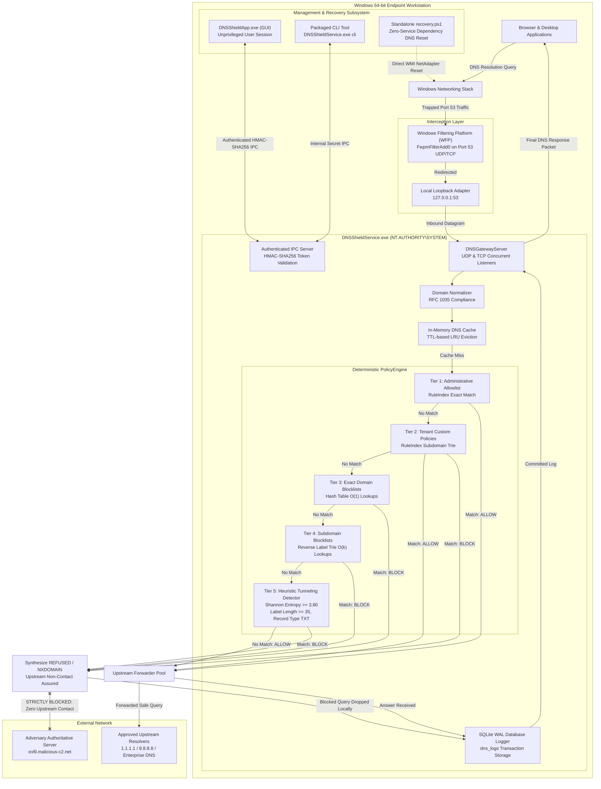

# DNS-SHIELD: ARCHITECTURE & SYSTEM DESIGN SPECIFICATION

## 1. COMPREHENSIVE COMPONENT INTERACTION DIAGRAM

---

## 2. PIPELINE PRECEDENCE & TIME COMPLEXITY

| Pipeline Stage | Evaluated Component | Data Structure | Time Complexity | Action on Match |
| :--- | :--- | :--- | :---: | :--- |
| **Stage 1** | Administrative Allowlist | In-Memory Hash Set | $O(1)$ | Terminate: **ALLOW** |
| **Stage 2** | Custom Tenant Rules | Exact Set & Subdomain Trie | $O(1) / O(k)$ | Terminate: **BLOCK** or **ALLOW** |
| **Stage 3** | Flat Domain Blocklist | Hash Table (1M+ entries) | $O(1)$ | Terminate: **BLOCK** (Local Drop) |
| **Stage 4** | Subdomain Blocklist | Reverse-Label Radix Trie | $O(k)$ | Terminate: **BLOCK** (Local Drop) |
| **Stage 5** | Tunneling Detection Heuristics | Shannon Entropy & Length Check | $O(L)$ | Terminate: **BLOCK** (Local Drop) |
| **Stage 6** | Default Forwarding | Upstream UDP Forwarder Pool | Network $RTT$ | Forward: **ALLOW** |

*Note: $k$ represents the number of domain labels; $L$ represents the character length of the query label.*
